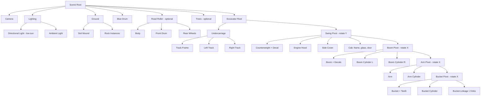

# ITS Environment 3D Scene

An animated WebGL 3D scene recreating selected objects and locations within the Institut Teknologi Sepuluh Nopember (ITS) campus, outside the Informatics Engineering Department. It demonstrates 3D transformations, camera, lighting, texture mapping, and hierarchical modelling.

[](https://www.khronos.org/webgl/)
[](https://developer.mozilla.org/en-US/docs/Web/JavaScript)
[](https://developer.mozilla.org/en-US/docs/Web/HTML)
[](https://developer.mozilla.org/en-US/docs/Web/CSS)

| | |
|---|---|
| **Group** | TODO: Group name |
| **Course** | Computer Graphics — Assignment 2 |
| **Semester / Year** | Semester 5, Academic Year 2026/2027 |
| **Institution** | Institut Teknologi Sepuluh Nopember (ITS), Surabaya, Indonesia |
| **Members** | Mikail Ibrahim Hakim (5025241046), Bara Semangat Rohmani (5025241144) |
| **Location** | TODO: Location name |
| **Status** | In Development |
| **Live Demo** | TODO: URL (e.g. GitHub Pages), or "Run locally — see [Running the Project](#running-the-project)" |

---

## Table of Contents

- [Overview](#overview)
- [Objectives](#objectives)
- [Assignment Compliance](#assignment-compliance)
- [Features](#features)
- [Scene and Objects](#scene-and-objects)
- [Animation](#animation)
- [Implementation](#implementation)
- [Hierarchical Modelling](#hierarchical-modelling)
- [Visual Documentation](#visual-documentation)
- [Task Distribution](#task-distribution)
- [Project Structure](#project-structure)
- [Running the Project](#running-the-project)
- [Limitations](#limitations)
- [References](#references)

---

## Overview

This project recreates a temporary construction area inside the ITS campus (outside the Informatics Engineering Department) as an animated 3D scene using WebGL. The selected location is the construction zone near the ITS Main Gate and ITS Student Dormitory, chosen because it is an active construction site with a distinctive, articulated machine (a crawler excavator) that is well suited to hierarchical modelling, and because it is clearly photographable and filmable from several angles.

> **Note on scope:** the scene is based on a temporary construction site. Its contents reflect the conditions on the day the reference photos and videos were taken (3 November 2026).

The original assignment brief is in [`docs/ASSIGNMENT.md`](docs/ASSIGNMENT.md).

## Objectives

By completing this project, the group demonstrates the ability to:

- Recreate real campus objects as a recognisable 3D scene.
- Apply translation, rotation, and scaling, and work with coordinate systems.
- Configure the camera and projection for scene viewing.
- Apply lighting and texture mapping to improve visual fidelity.
- Use hierarchical modelling to define parent-child relationships between objects.
- Develop time-based animation for selected objects.

## Assignment Compliance

**Main application page requirements** (all must be present in `index.html`, not only in this README):

| Requirement | Location | Status |
|---|---|---|
| Group name | Page header | ☐ |
| Photographs of actual objects | [Reference Photographs](#reference-photographs) | ☐ |
| Videos of actual objects | [Reference Videos](#reference-videos) | ☐ |
| Canvas placed near reference images | [Comparison](#comparison-with-the-real-environment) | ☐ |
| Hierarchy tree diagram | [Hierarchical Modelling](#hierarchical-modelling) | ☐ |
| Task distribution | [Task Distribution](#task-distribution) | ☐ |
| Implemented with WebGL | [Technologies](#technologies) | ☐ |

**Assessment criteria coverage:**

| Criterion | Where addressed |
|---|---|
| Complexity | [Object List](#object-list) (key components per object) |
| Similarity to real objects | [Comparison](#comparison-with-the-real-environment) |
| Task distribution | [Task Distribution](#task-distribution) |
| Lighting and texture | [Lighting](#lighting), [Textures](#textures) |
| Ability to explain implementation | [Implementation](#implementation), [Hierarchical Modelling](#hierarchical-modelling) |
| Ability to solve challenges | [Technical Challenges](#technical-challenges) |

## Features

<!-- Tick each item only after it is implemented and verified in the running application. -->

- [ ] 3D scene representing the selected ITS location
- [ ] Custom 3D object modelling
- [ ] Translation, rotation, and scaling
- [ ] Camera configuration and user control
- [ ] Lighting
- [ ] Texture mapping
- [ ] Hierarchical modelling
- [ ] Object animation

## Scene and Objects

**Location:** Construction Zone near ITS Main Gate and ITS Student Dormitory, along Jl. Teknik Elektro, Keputih, Sukolilo, Surabaya, East Java, Indonesia.  
**Description:** A temporary construction area with a distinctive crawler excavator and other construction equipment.

### Object List

| No. | Object | Key Components | Texture / Material | Status |
|---|---|---|---|---|
| 1 | Crawler excavator (Zoomlion ZE215E) | Undercarriage (2 tracks), upper structure, counterweight, engine hood, cab, boom, arm, bucket, 4 hydraulic cylinders, bucket linkage | Dull grey-black metal, lime-green paint (arm), decals (ZOOMLION, SN, boom number) | Must | Planned |
| 2 | Ground | Plane with white limestone/gravel surface | Tiled limestone texture | Must | Planned |
| 3 | Blue drum | Cylinder, top rim | Blue metal, label decal | Should | Planned |
| 4 | Soil and rock piles | Cone/low-poly mesh, several rock instances | Soil texture, limestone texture | Should | Planned |
| 5 | Road roller | Body, front drum, rear wheels, cab frame | Yellow paint, dark metal | Optional | Planned |
| 6 | Trees | Cylinder trunk, canopy | Bark texture, leaf colour | Optional | Planned |
    
*Status values: Planned / In Progress / Done.*

### Modelling Scope

**Included:** objects 1–4 (core), objects 5–6 only after the excavator is finished.

**Intentionally excluded:** background buildings, drainage ditch, puddles, litter, dry leaves, power lines, distant vehicles and motorcycles. These do not materially change recognisability and are represented by the sky colour and background only.

### Reference Dimensions (Zoomlion ZE215E)

Source: manufacturer specification. Values are transport dimensions.  
Scale unit: **1.0 = track length on ground (3380 mm)**.

| Dimension | mm | Scene units |
|---|---|---|
| Overall length (transport) | 9670 | 2.861 |
| Overall width | 2800 | 0.828 |
| Overall height (transport) | 3085 | 0.913 |
| Tail slewing radius | 2945 | 0.871 |
| Track gauge | 2200 | 0.651 |
| Length of track on ground | 3380 | 1.000 |

Boom length, arm length, bucket length, and cylinder anchor points are **not** in the specification. They are measured from the reference photographs (primarily the right-side view) as ratios to the track length, and recorded as estimates.

### Reference Photographs

<!-- Use original photos taken by the group, or credit the source. -->

| Object / Location | Reference Image | Source / Date |
|---|---|---|
| Excavator | [Front](assets/reference-images/excavator-front.jpg) | Own photo, 3 Nov 2026 |
| Excavator | [Front-right](assets/reference-images/excavator-front-right.jpg) | Own photo, 3 Nov 2026 |
| Excavator | [Right](assets/reference-images/excavator-right.jpg) | Own photo, 3 Nov 2026 |
| Excavator | [Rear-right](assets/reference-images/excavator-rear-right.jpg) | Own photo, 3 Nov 2026 |

### Reference Videos

- **TODO: Video title:** TODO: URL

## Animation

| Object | Animation Type | Transformation | Behaviour |
|---|---|---|---|
| Excavator upper structure | Swing | Rotate Y | Rotates toward the dig point and back |
| Boom | Lift/lower | Rotate X at boom pivot | Lowers to the ground and raises |
| Arm | Curl in/out | Rotate X at arm pivot | Pulls toward the cab while digging |
| Bucket | Scoop/dump | Rotate X at bucket pivot | Scrapes, curls up, then dumps |
| Hydraulic cylinders | Extend/retract | Barrel and rod stay aligned between two anchor points | Follows the joint it drives |
| Camera (optional) | Orbit | TODO | TODO |

**Dig cycle (one loop):** swing to dig point → boom down → arm curl in → bucket scoop → boom up → swing to dump point → bucket dump → swing back.

**Animation Method:** TODO: describe the render loop, delta time, and how animation state feeds the transformations.

## Implementation

### Technologies

| Technology | Purpose |
|---|---|
| WebGL 2 | Rendering the 3D scene |
| JavaScript (ES6+) | Scene logic, object management, transformations, animation |
| HTML5 | Page structure and canvas |
| CSS3 | Layout and presentation |

**External libraries:** TODO: "None — all matrix math and rendering are implemented directly" or list each library and its purpose.

### 3D Transformations

TODO: Explain how translation, rotation, and scaling are composed into model matrices, and the order of multiplication used.

### Camera

TODO: Describe projection type and parameters (FOV, near/far), camera position, view direction, and how the view matrix is built.

### Lighting

TODO: Describe the lighting model (e.g. Phong or Blinn-Phong), light sources and types (directional, point), and where it is computed (vertex or fragment shader).

### Textures

TODO: List textures, their sources/licences, and how UV coordinates map them to each object.

### Controls

| Input | Action |
|---|---|
| TODO: e.g. W / A / S / D | TODO: e.g. move camera |
| TODO: e.g. Mouse drag | TODO: e.g. orbit camera |
| TODO: e.g. Space | TODO: e.g. pause animation |

### Technical Challenges

| Challenge | Cause | Solution |
|---|---|---|
| TODO | TODO | TODO |

## Hierarchical Modelling

Child objects inherit the transformations of their parents. Each articulated joint is a **pivot node** whose origin sits at the physical joint, so rotating it moves every descendant around the correct point.



### Node Naming Contract

Node names used in the diagram and in the code must match. Any change must be updated in both places.

| Diagram node | Code identifier | Local transform |
|---|---|---|
| Excavator Root | `excavator` | translate + yaw of the whole machine |
| Swing Pivot | `swing` | rotate Y |
| Boom Pivot | `boomPivot` | rotate X |
| Arm Pivot | `armPivot` | rotate X |
| Bucket Pivot | `bucketPivot` | rotate X |

**Cylinders:** a cylinder needs two parts (barrel on the parent, rod on the moving part). Barrel and rod are re-oriented each frame between two anchor points, so the rod extends and retracts instead of rotating rigidly with the boom. If time is short, a single scaled and rotated cylinder is the fallback.

TODO: explain the actual implementation (matrix stack or scene-graph nodes) and one concrete propagation example.

## Visual Documentation

### Application Screenshot


### Comparison with the Real Environment

| Object | Actual Environment | WebGL Implementation |
|---|---|---|
| TODO | `` | `` |
| TODO | `` | `` |

### Animation Demonstration

- **Video:** TODO: URL
- **Format:** TODO: e.g. MP4

## Task Distribution

| Member | SID | Modules / Objects Owned | Details |
|---|---|---|---|
| Mikail Ibrahim Hakim | 5025241046 | Implementation | Geometry and modelling, hierarchy, animation, lighting, textures, camera, integration, main application page |
| Bara Semangat Rohmani | 5025241144 | Documentation, references, design specification | Repository, README and docs; reference photos and videos; object selection and scope; hierarchy tree and animation design; measuring proportions from photos; verifying the model against references |

Both members are able to explain the full implementation, not only their own modules.

## Project Structure

<!-- Adjust to match the actual repository and remove unused entries. -->

```text
its-environment-3d-scene/
├── README.md
├── index.html
├── src/
│   ├── main.js
│   ├── style.css
│   └── ...
├── assets/
│   ├── reference-images/
│   ├── reference-videos/
│   ├── screenshots/
│   └── textures/
└── docs/
    ├── ASSIGNMENT.md
    └── scene-hierarchy.md
```

## Running the Project

**Requirements:** a modern browser with WebGL 2 support, and a local web server. A server is required because browsers block loading textures from `file://` URLs.

Choose one of the following options.

### Option 1: Command line

```bash
# From the project root:
python -m http.server 8000
# or
npx serve .
```

Then open **http://localhost:8000** (for `npx serve`, use the URL printed in the terminal).

### Option 2: VS Code Live Server

1. Install the [Live Server](https://marketplace.visualstudio.com/items?itemName=ritwickdey.LiveServer) extension.
2. Open the project root (the folder containing `index.html`) in VS Code.
3. Right-click `index.html` and select **Open with Live Server**.
4. The app opens at `http://127.0.0.1:5500` and reloads on file changes.

TODO: Add any project-specific setup notes (browser tested, known compatibility issues).

## Limitations

- The excavator is built from primitives and custom meshes, so fine details (hoses, bolts, grilles) are simplified or omitted.
- Boom, arm, and cylinder proportions are estimated from photographs; some parts are partly occluded by trees in the photos.
- Only the excavator has articulated animation; other objects are static unless time allows.
- The real site is temporary and changes over time; the scene reflects one day's conditions.
- TODO: technical limitations after implementation.

## References

- [WebGL 2 Specification](https://www.khronos.org/webgl/)
- [MDN WebGL API Documentation](https://developer.mozilla.org/en-US/docs/Web/API/WebGL_API)
- TODO: Texture sources and licences
- TODO: Tutorials or modelling resources used