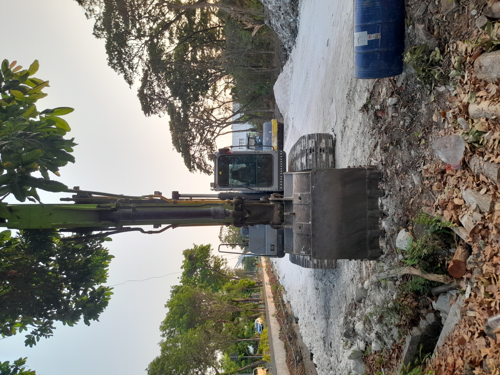
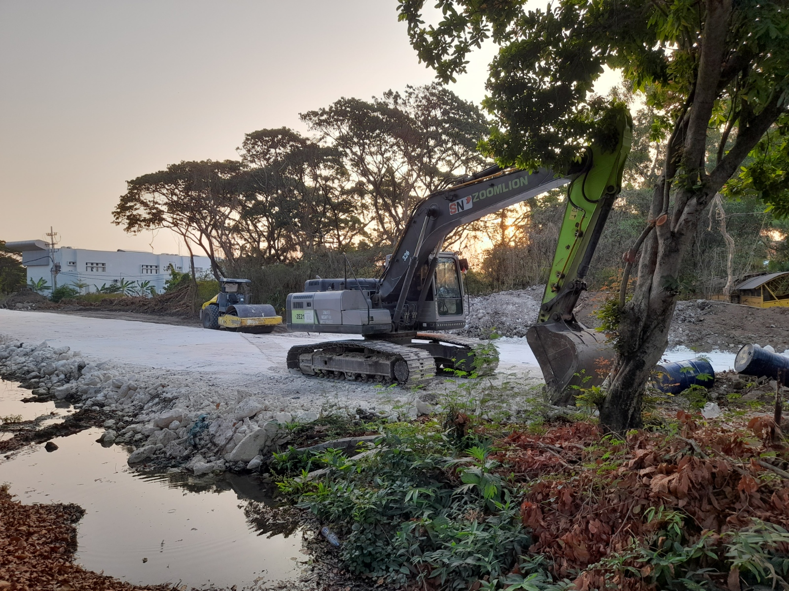
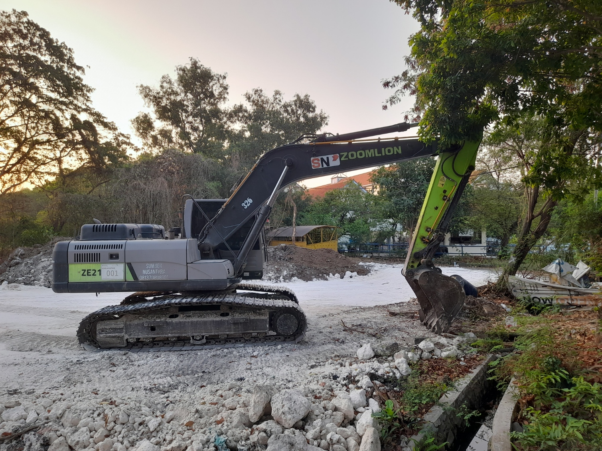
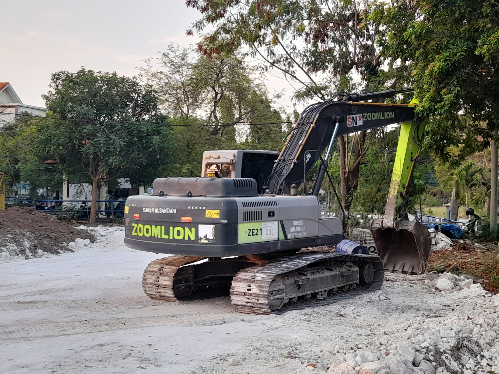
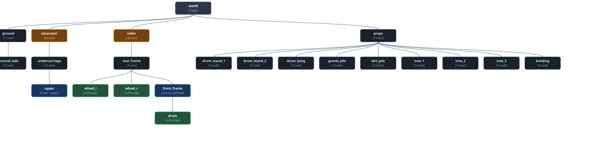

# ITS Environment 3D Scene

An animated WebGL scene of a road construction site near the Institut Teknologi Sepuluh Nopember (ITS) campus. The scene focuses on a Zoomlion excavator and includes a road roller, drums, gravel and dirt piles, trees, a building backdrop, and ground. It demonstrates transformations, camera control, lighting, texture mapping, hierarchical modelling, and animation.

[](https://www.khronos.org/webgl/)
[](https://developer.mozilla.org/en-US/docs/Web/JavaScript)
[](https://developer.mozilla.org/en-US/docs/Web/HTML)

| | |
|---|---|
| **Group** | Zoomlion |
| **Course** | Computer Graphics — Assignment 2 |
| **Semester / Year** | Semester 5, Academic Year 2026/2027 |
| **Institution** | Institut Teknologi Sepuluh Nopember (ITS), Surabaya, Indonesia |
| **Members** | Mikail Ibrahim Hakim (5025241046), Bara Semangat Rohmani (5025241144) |
| **Location** | Construction Zone near ITS Main Gate and ITS Student Dormitory, along Jl. Teknik Elektro, Keputih, Sukolilo, Surabaya, East Java, Indonesia |
| **Status** | Core scene implemented; submission page and site-fidelity work remain in progress |

---

## Table of Contents

- [Overview](#overview)
- [Objectives](#objectives)
- [Assignment Compliance](#assignment-compliance)
- [Assessment Criteria](#assessment-criteria)
- [Features](#features)
- [Scene and Objects](#scene-and-objects)
- [Animation](#animation)
- [Implementation](#implementation)
- [Hierarchical Modelling](#hierarchical-modelling)
- [Visual Documentation](#visual-documentation)
- [Task Distribution](#task-distribution)
- [Project Structure](#project-structure)
- [Running the Project](#running-the-project)
- [Limitations](#limitations)
- [References](#references)

---

## Overview

This project recreates a temporary construction area near the ITS Main Gate and student dormitory. The scene is built with raw WebGL 1 and JavaScript, and can be opened directly from `index.html`. The excavator, road roller, ground, and site props are assembled from generated model assets and a scene graph.

The project is being developed for the WebGL graphics assignment. Its current application page is a full-screen canvas; the assignment's photo/video comparison layout, group task information, and embedded hierarchy diagram have not yet been added to the page.

The assignment brief and project-specific setup are documented in [`docs/BRIEF.md`](docs/BRIEF.md) and [`SETUP.md`](SETUP.md).

## Objectives

The project demonstrates the ability to:

- Recreate recognizable objects and a location from the ITS environment.
- Apply translation, rotation, scaling, and coordinate-system conversions.
- Configure and control a perspective camera.
- Apply lighting and texture mapping.
- Organize moving and static objects with a scene graph.
- Animate the excavator and road roller over time.

## Assignment Compliance

The following are requirements for the **main application page**. A description or image in this README does not count as an item being present in `index.html`.

| Requirement | Current implementation | Status |
|---|---|---|
| Group name | Confirmed as Zoomlion; not yet shown on the application page | Incomplete |
| Photographs of actual objects | Reference photos are in [`assets/reference-images/`](assets/reference-images/) and [`scene/`](scene/); not shown on the page | Incomplete |
| Video of actual objects | No video has been provided yet | Missing |
| Canvas beside reference images | The current page contains a full-screen canvas only | Incomplete |
| Hierarchy tree diagram | Generated diagram is available at [`docs/scene_tree.svg`](docs/scene_tree.svg); not embedded on the page | Partial |
| Task distribution | Documented in this README; not shown on the page | Incomplete |
| WebGL implementation | The application uses WebGL 1 | Implemented |

The complete assignment checklist is in [`docs/BRIEF.md`](docs/BRIEF.md).

## Assessment Criteria

The assignment also grades complexity, similarity, task distribution, lighting and texture, ability to explain the implementation, and ability to solve challenges. The table below distinguishes what the repository already demonstrates from what still needs human review or presentation.

| Criterion | Evidence available in this repository | Status / next step |
|---|---|---|
| Complexity | Excavator, roller, ground, and props are in the scene; the generated scene tree and model tests document their hierarchy and moving parts. | Implemented; present the tree and explain the moving parts. |
| Similarity to the real environment | Four excavator reference views are in `assets/reference-images/`; the site photos are in `scene/`. The scene also includes a roller, drums, piles, trees, and a building. | Partial; compare the render beside the photos and address the low-fidelity site objects and ground. |
| Task distribution | Member responsibilities are listed in [Task Distribution](#task-distribution). | Documented here; still needs to be added to the main application page. |
| Lighting and texture | The app uses Blinn-Phong lighting, an imported excavator colour map, and generated textures. | Basic implementation is present; visual polish and a clear photo comparison remain. |
| Explain the implementation | This README describes transformations, camera, lighting, textures, animation, and hierarchy. The interfaces are documented in [`ENGINE_API.md`](ENGINE_API.md). | Partially prepared; explain the implementation aloud and verify that both members can do so. |
| Solve challenges | The challenge practice list below points to existing configuration, scene, and asset-building code. | Practice prompts are prepared; the team still needs to rehearse and demonstrate changes live. |

### Quick Wins from Existing Repository Content

These items can be documented now from files already present. They improve the project record, but do **not** satisfy the corresponding main-page requirement until added to `index.html`.

- Group name and location are confirmed above.
- Reference photos can be linked from `assets/reference-images/` and `scene/`.
- The live hierarchy diagram already exists at [`docs/scene_tree.svg`](docs/scene_tree.svg).
- Controls and member responsibilities are described in this README.
- The main implementation concepts and their code entry points are summarized below.

## Features

- [x] 3D scene representing the selected ITS construction site
- [x] Excavator, road roller, ground, drums, piles, trees, and building backdrop
- [x] Translation, rotation, scaling, and scene-graph hierarchy
- [x] Orbit camera, four camera presets, and excavator follow camera
- [x] Blinn-Phong lighting with ambient and directional components
- [x] Embedded texture assets and generated textures
- [x] Excavator and road roller animation
- [ ] Submission page with reference photos, video, task split, and hierarchy diagram
- [ ] Final site likeness and photo-based ground/backdrop work

## Scene and Objects

**Location:** Construction Zone near ITS Main Gate and ITS Student Dormitory, along Jl. Teknik Elektro, Keputih, Sukolilo, Surabaya, East Java, Indonesia.

### Object List

| No. | Object | Key Components / Behaviour | Status |
|---|---|---|---|
| 1 | Zoomlion crawler excavator | Imported mesh; drives and turns as a whole, with a slewing upper structure. Boom, stick, and bucket are not independently articulated. | Implemented (level 2) |
| 2 | Ground | Ground and slab model; photo-based ground detailing is still planned. | Implemented |
| 3 | Blue drums | Three site drums, including one lying down. | Implemented |
| 4 | Gravel and dirt piles | Separate gravel and dirt props. | Implemented |
| 5 | Road roller | Rear frame and wheels, articulating front frame, and rotating drum. | Implemented |
| 6 | Trees and building | Three simple trees and a building backdrop. | Implemented (simplified) |

### Modelling Scope

The current scene covers the main machine, roller, ground, and site props. The excavator is at articulation **level 2**: the whole machine can drive and turn, and its upper body can slew. Independent boom, stick, bucket, and hydraulic-cylinder movement is a separate, optional future task.

The trees, building, and ground remain simplified compared with the reference location. Photo-based ground and distant vegetation work is tracked in [`BACKLOG.md`](BACKLOG.md).

### Reference Dimensions (Zoomlion ZE215E)

The imported excavator is scaled against the manufacturer dimensions and reference photos. The current measured model is approximately **2.75 m wide** and **4.25 m long at the tracks**, compared with project targets of approximately 2.80 m and 4.18 m. Some proportions were estimated from photos.

### Reference Photographs

| View | Reference Image |
|---|---|
| Front |  |
| Front-right |  |
| Right |  |
| Rear-right |  |

Original site photos are also kept in [`scene/`](scene/).

### Reference Videos

No reference video has been provided yet. The assignment requires a video of the real object; add it to the project and link it here and on the application page when available.

## Animation

| Object | Animation | Behaviour |
|---|---|---|
| Excavator | Drive, turn, and slew | Auto mode runs a looping work sequence; manual input is also available. |
| Road roller | Drive, articulate, and roll | Moves along the site; wheels and drum rotate according to travel distance. |
| Camera | Orbit, presets, follow | Orbit manually, select one of four reference views, or follow the excavator. |

**Excavator auto cycle:** drive forward, pause, slew, pause, slew back, and drive back. Pressing a movement key switches to manual mode; `Space` toggles between auto and manual modes.

**Animation method:** `WORLD.update(dt, t, input)` updates scene state on each animation frame. Time and input drive node pivots and joint angles; the scene graph propagates parent transforms to child objects.

## Implementation

### Technologies

| Technology | Purpose |
|---|---|
| WebGL 1 | Rendering |
| JavaScript | Scene graph, camera, rendering, controls, and animation |
| HTML5 Canvas | Application display |
| Python and CadQuery | Build-time geometry generation and asset export |

**External libraries at runtime:** None. The browser application uses plain JavaScript and WebGL 1. Python packages are used only by the model-building and verification tools.

### Implementation Map

| Concept | Code entry point | What to explain |
|---|---|---|
| Transformations | `src/math.js`, `src/scene.js` | `Mat4` stores column-major matrices; each node composes its local transform and inherits its parent's world transform. |
| Camera | `src/camera.js`, `src/main.js`, and `SCENE_CONFIG` in `index.html` | The camera supports orbit, configured presets, and a follow pose based on the excavator. |
| Lighting | `src/shaders.js` and `SCENE_CONFIG.light` in `index.html` | The shaders combine Blinn-Phong lighting with hemisphere ambient and a directional sun. |
| Textures | `tools/build_textures.py` and the embedded texture assets | Builders generate textures that the page loads as scripts, preserving `file://` compatibility. |
| Hierarchical modelling | `src/scene.js`, `src/world.js`, and `tools/scene_tree.js` | Parent nodes place children at pivots; the generated SVG visualizes the live world hierarchy. |
| Animation | `src/world.js` (`WORLD.build` and `WORLD.update`) | Time and held input update machine movement and joints; roller tests cover the rolling relationship. |

### 3D Transformations

Scene dimensions use metres. The WebGL scene is right-handed and Y-up; CadQuery builders use Z-up, with the conversion performed by the exporter. Matrices are 4x4 column-major arrays. A node's local transform is composed as translation, rotation, then scale (`T * R * S`), and its world transform is `parentWorld * local`.

### Camera

The default camera is a perspective orbit camera, controlled by mouse drag and wheel. Keys `1`-`4` select views aligned with the four reference photos, and `F` toggles a follow camera behind the excavator. The view and projection matrices are built by the project's math utilities.

### Lighting

The renderer uses a Blinn-Phong model with hemisphere ambient light and one directional sun. The sun and sky/ground colours are configured in `index.html`. The current scene uses a dusk-oriented palette; further lighting polish remains in the backlog.

### Textures

The excavator uses the colour texture from its imported Meshy model. Other textures are generated by `tools/build_textures.py`. Texture data is embedded in JavaScript assets and loaded with script tags, so the application does not need network requests or a local server.

### Controls

| Input | Action |
|---|---|
| `W` / `S` | Drive the excavator forward / backward |
| `A` / `D` | Turn the excavator |
| `Q` / `E` | Slew the excavator upper structure |
| `Space` | Toggle auto / manual animation mode |
| Mouse drag | Orbit the camera |
| Mouse wheel | Zoom the camera |
| `1`-`4` | Select a camera preset |
| `F` | Toggle the excavator follow camera |

For automated checks and still renders, `?test` and `?shot` URL modes are also available.

### Challenge Practice (Repository-Based)

Use these prompts to rehearse small, explainable changes using existing project code. They are practice pointers, not evidence that a live challenge has already been completed.

| Challenge prompt | Where to make the change |
|---|---|
| Make the sun warmer or change its direction. | Adjust `SCENE_CONFIG.light.sunColor` or `sunDir` in `index.html`. |
| Change the sky or ground ambient colour. | Adjust `SCENE_CONFIG.light.skyColor` or `groundColor` in `index.html`. |
| Move a camera preset or change its zoom. | Edit that preset's `target` or `distance` in `SCENE_CONFIG.cameraPresets` in `index.html`. |
| Change the default orbit camera framing. | Edit `SCENE_CONFIG.camera` in `index.html`. |
| Reposition the excavator or road roller. | Change the model root pivot in `WORLD.build` in `src/world.js`. |
| Explain or adjust manual driving and slewing. | Trace the input handling in `WORLD.update` in `src/world.js`; controls are W/S, A/D, and Q/E. |
| Change the excavator's automatic work cycle. | Edit the auto-mode state updates in `WORLD.update` in `src/world.js`; keep the movement tests passing. |
| Make the road roller travel or roll differently. | Trace roller movement and rotation in `src/world.js`; `tests/roller.test.js` checks the rolling relationship. |
| Change a generated texture. | Edit the relevant generator in `tools/build_textures.py`, then rebuild and check the embedded texture asset. |
| Add a child model part and show it in the tree. | Define the part and parent in a `builders/*.py` model, export it with `tools/export.py`, then update scene setup and regenerate `docs/scene_tree.svg` with `tools/scene_tree.js`. |

### Technical Challenges

| Challenge | Cause | Solution |
|---|---|---|
| Dark or bright patches on the imported excavator | Some imported triangles have inward winding | Preserve the imported smooth normals and draw the imported model double-sided; regression checks cover the shading behaviour. |
| Slow initial page load | Large embedded excavator mesh and texture assets | Keep generated assets embedded for `file://` compatibility; the model and texture payloads are currently large. |
| Reliable render verification | Browser texture decoding can outlast a virtual-clock wait | The render check waits in real time for assets to decode. |

## Hierarchical Modelling

The live scene graph uses `SceneNode` pivots. A child inherits its parent's world transform, so moving a machine root moves its complete model, while a rotating joint affects only its descendants. The road roller's rolling parts and front articulation are represented as separate nodes.

The generated tree is kept in sync with the scene graph by `tools/scene_tree.js`:



| Node | Role |
|---|---|
| `excavator` | Machine root; drive and heading |
| `undercarriage` | Excavator lower structure |
| `upper` | Excavator upper structure; yaw slew |
| `roller` | Road roller root; drive |
| `rear_frame` | Rear structure and wheel parents |
| `front_frame` | Articulating front structure |
| `drum` | Road roller drum; rolling rotation |

The excavator is currently level 2; separate arm joints and hydraulic-cylinder motion are not implemented.

## Visual Documentation

### Application Screenshot

A final scene screenshot has not been added to the repository yet.

### Comparison with the Real Environment

| Object | Reference | WebGL implementation |
|---|---|---|
| Excavator, front | [Front photo](assets/reference-images/excavator-front.jpg) | Final comparison screenshot not yet added |
| Excavator, side | [Right-side photo](assets/reference-images/excavator-right.jpg) | Final comparison screenshot not yet added |
| Construction site | Photos in [`scene/`](scene/) | Final comparison screenshot not yet added |

### Animation Demonstration

- **Video:** Not available yet; the real-site video remains a required human-provided item.

## Task Distribution

| Member | SID | Modules / Objects Owned | Details |
|---|---|---|---|
| Mikail Ibrahim Hakim | 5025241046 | Implementation | Geometry and modelling, hierarchy, animation, lighting, textures, camera, integration, and application page |
| Bara Semangat Rohmani | 5025241144 | Documentation, references, design specification | Repository documentation, reference photos and video, object selection and scope, hierarchy and animation design, proportions from photos, and model/reference comparison |

Both members should be prepared to explain the complete implementation, not only their assigned parts.

## Project Structure

```text
its-environment-3d-scene/
|-- index.html                 Application page and scene configuration
|-- README.md
|-- AGENTS.md                  Project instructions
|-- BACKLOG.md                 Planned work and acceptance checks
|-- CONVENTIONS.md             Coordinate, matrix, and runtime rules
|-- ENGINE_API.md              Engine interfaces
|-- PROGRESS.md                Decisions and completed work
|-- SETUP.md                   Windows setup and checks
|-- builders/                  CadQuery model builders
|-- assets/
|   |-- models/                Generated model JavaScript
|   |-- textures*.js           Generated embedded textures
|   |-- reference-images/      Named reference photos
|   |-- reference-videos/      Reference video (not available yet)
|   `-- screenshots/           Final screenshots (not added yet)
|-- docs/
|   |-- BRIEF.md               Assignment requirements
|   |-- CAMERA.md              Camera controls and presets
|   |-- HANDOFF_SITE.md        Site-fidelity work specification
|   `-- scene_tree.svg         Generated live scene hierarchy
|-- scene/                     Original site reference photos
|-- spec/                      Model dimensions and import settings
|-- src/                       WebGL engine, camera, and world logic
|-- tests/                     Node tests and browser probe page
`-- tools/                     Export, texture, tree, and check scripts
```

## Running the Project

**View the application:** open `index.html` directly in a modern browser with WebGL 1 support. The page is designed to work from `file://`; a local web server is not required.

**Run the project checks:** install the Python and Node.js prerequisites described in [`SETUP.md`](SETUP.md), then run from the project root:

```bash
python tools/check_all.py
```

The check script runs the project checks and prints a summary. Re-exporting models is only needed when their builders or inputs change.

## Limitations

- The excavator is at articulation level 2; the boom, stick, bucket, and hydraulic cylinders do not move independently.
- The road roller, trees, building, and some site props are simplified compared with the real photos.
- The ground colour and site details do not yet match the light limestone construction area closely.
- Photo-based ground, vegetation, and backdrop improvements remain in progress.
- The main page does not yet include the reference photos, real-site video, task distribution, or hierarchy diagram required for submission.
- The real site is temporary; the scene represents the conditions in the available reference photos.

## References

- [WebGL 1 Specification](https://www.khronos.org/registry/webgl/specs/latest/1.0/)
- [MDN WebGL API Documentation](https://developer.mozilla.org/en-US/docs/Web/API/WebGL_API)
- Project reference photographs: [`assets/reference-images/`](assets/reference-images/) and [`scene/`](scene/)
- Project conventions and engine interface: [`CONVENTIONS.md`](CONVENTIONS.md), [`ENGINE_API.md`](ENGINE_API.md)
- Meshy model and colour texture are imported project inputs; confirm their attribution and licence before submission.
