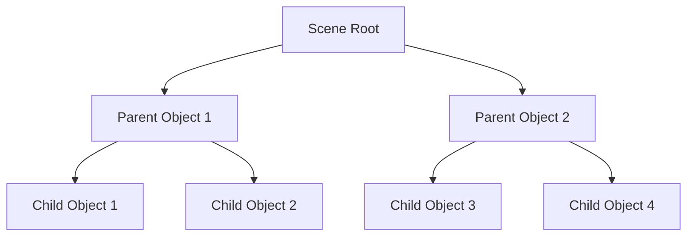

# ITS Environment 3D Scene

An animated WebGL 3D scene recreating selected objects and locations within the Institut Teknologi Sepuluh Nopember (ITS) campus, outside the Informatics Engineering Department. It demonstrates 3D transformations, camera, lighting, texture mapping, and hierarchical modelling.

[](https://www.khronos.org/webgl/)
[](https://developer.mozilla.org/en-US/docs/Web/JavaScript)
[](https://developer.mozilla.org/en-US/docs/Web/HTML)
[](https://developer.mozilla.org/en-US/docs/Web/CSS)

| | |
|---|---|
| **Group** | TODO: Group name |
| **Course** | Computer Graphics — Assignment 2 |
| **Semester / Year** | Semester 5, Academic Year 2026/2027 |
| **Institution** | Institut Teknologi Sepuluh Nopember (ITS), Surabaya, Indonesia |
| **Members** | Mikail Ibrahim Hakim (5025241046), Bara Semangat Rohmani (5025241144) |
| **Location** | TODO: Location name |
| **Status** | In Development |
| **Live Demo** | TODO: URL (e.g. GitHub Pages), or "Run locally — see [Running the Project](#running-the-project)" |

---

## Table of Contents

- [Overview](#overview)
- [Objectives](#objectives)
- [Assignment Compliance](#assignment-compliance)
- [Features](#features)
- [Scene and Objects](#scene-and-objects)
- [Animation](#animation)
- [Implementation](#implementation)
- [Hierarchical Modelling](#hierarchical-modelling)
- [Visual Documentation](#visual-documentation)
- [Task Distribution](#task-distribution)
- [Project Structure](#project-structure)
- [Running the Project](#running-the-project)
- [Limitations](#limitations)
- [References](#references)

---

## Overview

This project recreates selected objects from the ITS campus (excluding the Informatics Engineering Department) as an animated 3D scene using WebGL. The selected location is **TODO: Location name**, chosen because **TODO: one-sentence rationale, e.g. distinctive structures and clear reference material**.

The original assignment brief is in [`docs/ASSIGNMENT.md`](docs/ASSIGNMENT.md).

## Objectives

By completing this project, the group demonstrates the ability to:

- Recreate real campus objects as a recognisable 3D scene.
- Apply translation, rotation, and scaling, and work with coordinate systems.
- Configure the camera and projection for scene viewing.
- Apply lighting and texture mapping to improve visual fidelity.
- Use hierarchical modelling to define parent-child relationships between objects.
- Develop time-based animation for selected objects.

## Assignment Compliance

**Main application page requirements** (all must be present in `index.html`, not only in this README):

| Requirement | Location | Status |
|---|---|---|
| Group name | Page header | ☐ |
| Photographs of actual objects | [Reference Photographs](#reference-photographs) | ☐ |
| Videos of actual objects | [Reference Videos](#reference-videos) | ☐ |
| Canvas placed near reference images | [Comparison](#comparison-with-the-real-environment) | ☐ |
| Hierarchy tree diagram | [Hierarchical Modelling](#hierarchical-modelling) | ☐ |
| Task distribution | [Task Distribution](#task-distribution) | ☐ |
| Implemented with WebGL | [Technologies](#technologies) | ☐ |

**Assessment criteria coverage:**

| Criterion | Where addressed |
|---|---|
| Complexity | [Object List](#object-list) (key components per object) |
| Similarity to real objects | [Comparison](#comparison-with-the-real-environment) |
| Task distribution | [Task Distribution](#task-distribution) |
| Lighting and texture | [Lighting](#lighting), [Textures](#textures) |
| Ability to explain implementation | [Implementation](#implementation), [Hierarchical Modelling](#hierarchical-modelling) |
| Ability to solve challenges | [Technical Challenges](#technical-challenges) |

## Features

<!-- Tick each item only after it is implemented and verified in the running application. -->

- [ ] 3D scene representing the selected ITS location
- [ ] Custom 3D object modelling
- [ ] Translation, rotation, and scaling
- [ ] Camera configuration and user control
- [ ] Lighting
- [ ] Texture mapping
- [ ] Hierarchical modelling
- [ ] Object animation

## Scene and Objects

**Location:** TODO: Location name  
**Description:** TODO: Brief description of the area and its main characteristics.

### Object List

| No. | Object | Key Components | Texture / Material | Status |
|---|---|---|---|---|
| 1 | TODO | TODO: e.g. base, 4 pillars, roof | TODO | Planned |
| 2 | TODO | TODO | TODO | Planned |
| 3 | TODO | TODO | TODO | Planned |

*Status values: Planned / In Progress / Done.*

### Reference Photographs

<!-- Use original photos taken by the group, or credit the source. -->

| Object / Location | Reference Image | Source / Date |
|---|---|---|
| TODO | `assets/reference-images/TODO.jpg` | TODO |
| TODO | `assets/reference-images/TODO.jpg` | TODO |

### Reference Videos

- **TODO: Video title:** TODO: URL

## Animation

| Object | Animation Type | Transformation | Behaviour |
|---|---|---|---|
| TODO | TODO: e.g. rotation | TODO: e.g. rotate Y, 30°/s | TODO: e.g. continuous loop |
| TODO | TODO | TODO | TODO |

**Animation Method:** TODO: describe the render loop (e.g. `requestAnimationFrame`), how delta time is computed, and how animation state feeds the transformations.

## Implementation

### Technologies

| Technology | Purpose |
|---|---|
| WebGL 2 | Rendering the 3D scene |
| JavaScript (ES6+) | Scene logic, object management, transformations, animation |
| HTML5 | Page structure and canvas |
| CSS3 | Layout and presentation |

**External libraries:** TODO: "None — all matrix math and rendering are implemented directly" or list each library and its purpose.

### 3D Transformations

TODO: Explain how translation, rotation, and scaling are composed into model matrices, and the order of multiplication used.

### Camera

TODO: Describe projection type and parameters (FOV, near/far), camera position, view direction, and how the view matrix is built.

### Lighting

TODO: Describe the lighting model (e.g. Phong or Blinn-Phong), light sources and types (directional, point), and where it is computed (vertex or fragment shader).

### Textures

TODO: List textures, their sources/licences, and how UV coordinates map them to each object.

### Controls

| Input | Action |
|---|---|
| TODO: e.g. W / A / S / D | TODO: e.g. move camera |
| TODO: e.g. Mouse drag | TODO: e.g. orbit camera |
| TODO: e.g. Space | TODO: e.g. pause animation |

### Technical Challenges

| Challenge | Cause | Solution |
|---|---|---|
| TODO | TODO | TODO |

## Hierarchical Modelling

Child objects inherit the transformations of their parents: moving, rotating, or scaling a parent applies to all of its descendants, while each child keeps its own local transformation.



TODO: Explain how the hierarchy is implemented (e.g. a matrix stack or scene-graph nodes) and give one concrete example, such as which transformation propagates to which child.

## Visual Documentation

### Application Screenshot


### Comparison with the Real Environment

| Object | Actual Environment | WebGL Implementation |
|---|---|---|
| TODO | `` | `` |
| TODO | `` | `` |

### Animation Demonstration

- **Video:** TODO: URL
- **Format:** TODO: e.g. MP4

## Task Distribution

| Member | SID | Modules / Objects Owned | Details |
|---|---|---|---|
| Mikail Ibrahim Hakim | 5025241046 | TODO | TODO |
| Bara Semangat Rohmani | 5025241144 | TODO | TODO |

Both members are able to explain the full implementation, not only their own modules.

## Project Structure

<!-- Adjust to match the actual repository and remove unused entries. -->

```text
its-environment-3d-scene/
├── README.md
├── index.html
├── src/
│   ├── main.js
│   ├── style.css
│   └── ...
├── assets/
│   ├── reference-images/
│   ├── reference-videos/
│   ├── screenshots/
│   └── textures/
└── docs/
    ├── ASSIGNMENT.md
    └── scene-hierarchy.md
```

## Running the Project

**Requirements:** a modern browser with WebGL 2 support, and a local web server. A server is required because browsers block loading textures from `file://` URLs.

Choose one of the following options.

### Option 1: Command line

```bash
# From the project root:
python -m http.server 8000
# or
npx serve .
```

Then open **http://localhost:8000** (for `npx serve`, use the URL printed in the terminal).

### Option 2: VS Code Live Server

1. Install the [Live Server](https://marketplace.visualstudio.com/items?itemName=ritwickdey.LiveServer) extension.
2. Open the project root (the folder containing `index.html`) in VS Code.
3. Right-click `index.html` and select **Open with Live Server**.
4. The app opens at `http://127.0.0.1:5500` and reloads on file changes.

TODO: Add any project-specific setup notes (browser tested, known compatibility issues).

## Limitations

- TODO: Modelling simplifications compared with the real objects.
- TODO: Differences between the real environment and the implementation.
- TODO: Technical limitations or incomplete features.

## References

- [WebGL 2 Specification](https://www.khronos.org/webgl/)
- [MDN WebGL API Documentation](https://developer.mozilla.org/en-US/docs/Web/API/WebGL_API)
- TODO: Texture sources and licences
- TODO: Tutorials or modelling resources used